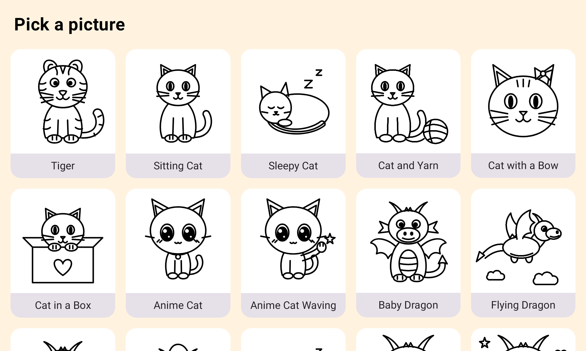
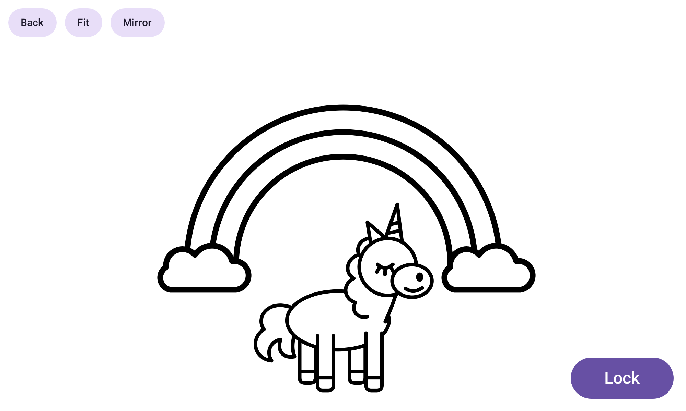
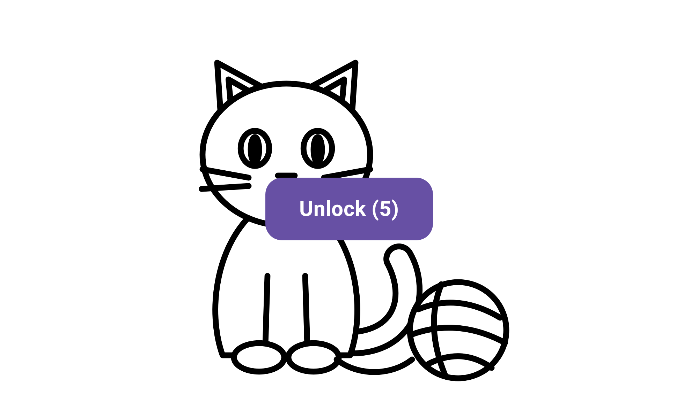
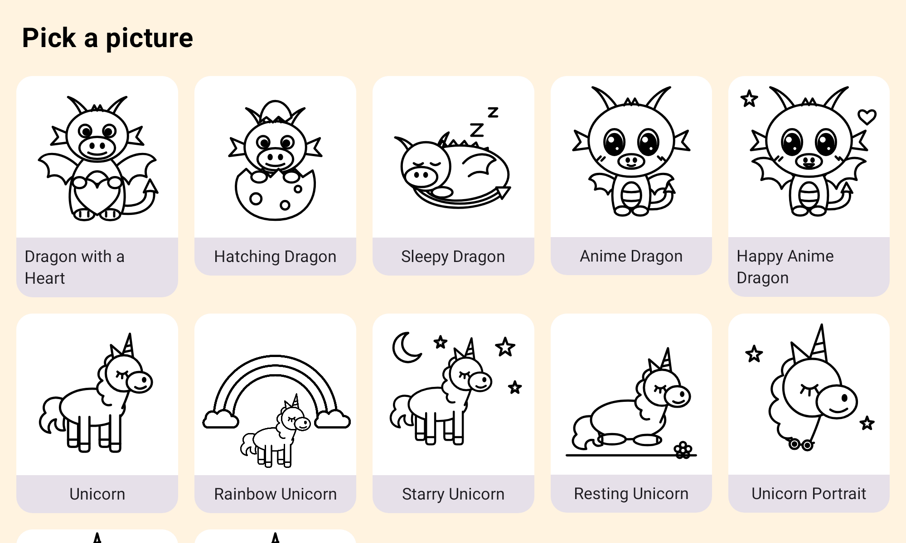
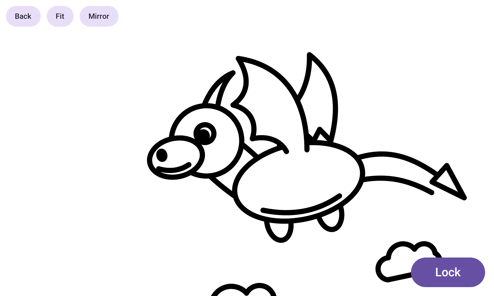
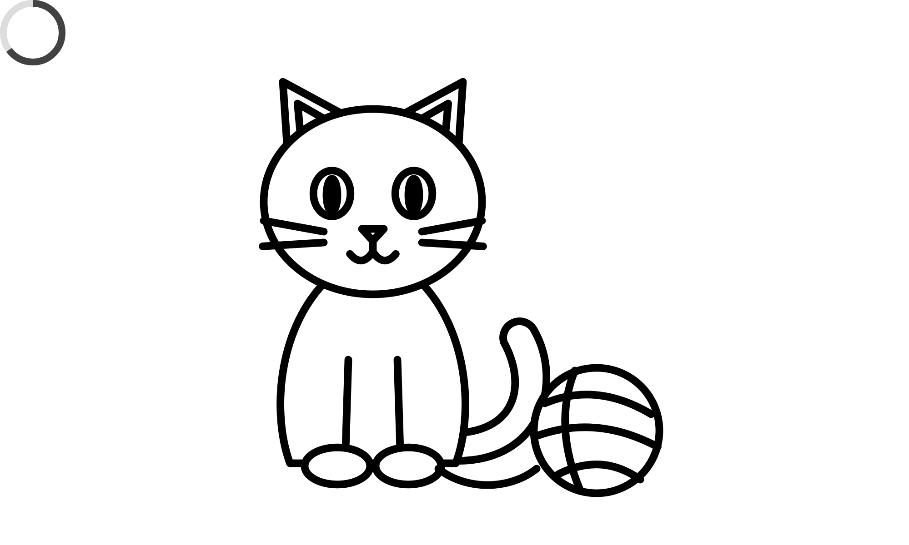

<p align="center">
  
</p>

<h1 align="center">Tracing Lightbox</h1>

<p align="center">
  <b>Turn your tablet into a glowing tracing table.</b><br>
  Art &amp; Design · Rated for Everyone · Free · No ads · No in-app purchases
</p>

<p align="center">
  
  
  
</p>

> *"It's perfect."* — our first tester

---

## About this app

**Put paper on your tablet and trace like a pro.** Tracing Lightbox lights up a
bold black outline on a bright white screen, so it shines right through a sheet of
paper. Pick a picture, slide it into place, press **Lock**, and trace. Elbows, palms
and wiggly fingers can't bump the picture out of place.

✏️ **22 pictures to trace.** Cats, dragons and unicorns, including cute anime-style
ones, plus a tiger. Thick, clear lines, made to be traced with a pencil.

🖐️ **Fit it to your paper.** Drag to move, pinch to zoom, twist with two fingers to
turn. **Mirror** flips the picture so your dragon can fly the other way.

💖 **Add little extras.** Tap the heart, star, rainbow or cloud buttons to sprinkle
up to 5 extras around the picture. They never cover the picture and move along with
it. **Clear** takes them away.

🔒 **Lock means locked.** Once it's locked, touching the screen does nothing. No
buttons, no accidental swipes. Just you, your pencil and the picture.

☀️ **Bright and steady.** Locking turns the screen to full brightness and keeps it
on, so the lines stay clear the whole time you trace.

🧠 **Remembers your spot.** Each picture keeps the size and position you gave it, so
you can come back tomorrow and finish on the same sheet.

🛡️ **Private by design.** No internet, no accounts, no ads, no tracking. The app
doesn't even ask for permissions.

## Screenshots

| | |
|---|---|
|  |  |
| **Pick a picture.** Tap any card to start. | **Dragons and unicorns too.** Scroll for more. |
|  |  |
| **Line it up.** Move, zoom and turn it to fit your paper. | **Make it yours.** Zoom in, tilt it, or mirror it. |
|  |  |
| **Locked.** To finish, hold the top-left corner until the ring fills… | **…then tap Unlock.** It disappears after 5 seconds if you don't. |

## How to use it

1. **Pick a picture** from the library.
2. **Lay your paper on the screen.** Drag, pinch and twist the picture until it sits
   where you want it on the paper. **Fit** puts it back in the middle;
   **Mirror** flips it. Want hearts or stars around it? Tap the heart, star, rainbow
   or cloud buttons, one per tap, up to 5. **Clear** removes them.
3. **Press Lock.** The buttons disappear and the screen goes extra bright.
4. **Trace!** Hold the paper still with your other hand. Nothing on the screen will
   move, even if you lean on it.
5. **All done?** Press and hold the **top-left corner** with one fingertip for
   3 seconds until the ring fills up, then tap the big **Unlock** button.

**Tips for the best tracing**

- Use thin printer paper. Thick drawing paper hides the lines.
- Trace in a dim room. The darker the room, the brighter the lines look.
- Press gently with your pencil. The screen is under the paper!
- Tape the corners of the paper down if it keeps sliding.

## What's new in 1.1

- 21 new pictures: cats, dragons and unicorns, including anime-style ones.
- A new app icon: a pencil tracing a star.

## App info

| | |
|---|---|
| **Version** | 1.1 |
| **Works on** | Android 9 or newer. Made for tablets (built on a Samsung Galaxy Tab S6 Lite). |
| **Permissions** | None |
| **Data collected** | None. Works completely offline. |
| **Ads / purchases** | None |

## Get it

Tracing Lightbox isn't on the Play Store. It's a free APK you install directly.
Download the latest `tracing-lightbox-<version>.apk` from this repo's **Releases**
page on the tablet, open it, and allow "Install unknown apps" when Android asks.
Android may warn that the app is from an unknown developer. That's expected for apps
from outside the Play Store. Full steps are in [Install from GitHub](#install-from-github-no-computer-needed)
below.

You don't need the kiosk setup below to use it. **Lock** already blocks every
touch. Kiosk mode is an extra for a tablet that's only used for tracing.

---

# For grown-ups: building and setup

Built for a Samsung Galaxy Tab S6 Lite. No internet, no permissions, no accounts.
Screenshots above are rendered from the real app screens (`docs/screenshots/`).

## Build

```powershell
$env:JAVA_HOME = "C:\Program Files\Android\Android Studio\jbr"
.\gradlew.bat assembleDebug testDebugUnitTest
```

The APK is at `app\build\outputs\apk\debug\app-debug.apk`.

## Adding pictures

1. Put the file in `app/src/main/assets/pictures/`. SVG (preferred), PNG, or JPG.
2. Add a line to `app/src/main/assets/pictures/manifest.json`:
   `{ "id": "lion", "name": "Lion", "file": "lion.svg" }` (ids must be unique).
3. Rebuild and reinstall.

Picture rules, so it shows clearly through paper:

- Pure black lines on a pure white background. No grey, no shading, no color fills.
- Lines thick enough to see through paper (in a 1000-unit SVG, a stroke of about 14).
- Nothing tiny: a 6-year-old traces it with a pencil.
- Only free-to-use (public domain / CC0 / explicit permission) or original art. Many
  coloring-page sites forbid copying their pages, even into a private app.

## Install from GitHub (no computer needed)

Each release on the repo's **Releases** page has two APKs:

| File | Install by | Kiosk mode can be undone by |
|---|---|---|
| `tracing-lightbox-<version>.apk` | tapping it on the tablet | factory reset only |
| `tracing-lightbox-<version>-usb.apk` | USB from a PC (`adb install -t`) | one USB command |

To tap-install: on the tablet, open the release page in the browser (the repo is private,
so sign in to GitHub in the browser), download `tracing-lightbox-<version>.apk`, open it,
and allow "Install unknown apps" for the browser when asked.

Both APKs are signed with the same key, from the PC they were built on. Keep building
releases on that PC so updates install over the old version without uninstalling.

To publish a new release (from the repo folder, on that PC):

```powershell
$env:JAVA_HOME = "C:\Program Files\Android\Android Studio\jbr"
.\gradlew.bat assembleRelease assembleDebug
copy app\build\outputs\apk\release\app-release.apk tracing-lightbox-v1.1.apk
copy app\build\outputs\apk\debug\app-debug.apk tracing-lightbox-v1.1-usb.apk
gh release create v1.1 tracing-lightbox-v1.1.apk tracing-lightbox-v1.1-usb.apk --notes "What changed"
```

(Bump `versionCode` and `versionName` in `app/build.gradle.kts` first.)

## Install on a tablet over USB

1. On the tablet: Settings → About tablet → Software information → tap **Build number** 7
   times to turn on Developer options. Then Settings → Developer options → turn on
   **USB debugging**.
2. Connect the tablet by USB and accept the "Allow USB debugging?" prompt.
3. From the repo folder:

```powershell
$adb = "$env:LOCALAPPDATA\Android\Sdk\platform-tools\adb.exe"
& $adb install -t -r app\build\outputs\apk\debug\app-debug.apk
```

(`-t` is required: debug builds are marked test-only so kiosk mode can be undone.)

Without the kiosk setup below, **Lock** still blocks every touch, keeps the screen on at
full brightness and pins the app, but Android asks to confirm pinning each time and the
"swipe up and hold" gesture can unpin it.

## Set up a tablet (kiosk mode)

Kiosk mode makes **Lock** a true lock: no confirmation, no Home/Recents/Back, no
notification shade. Samsung's Edge panel and S Pen Air Command should be blocked too
(confirm on the tablet). The only way out is the app's own unlock
(hold the top-left corner for 3 seconds, then tap **Unlock**).

Android only allows this on a tablet with **no accounts** on it.

**Before turning on kiosk mode, test the unlock on this tablet without it.** Lock a
picture, then hold the top-left corner with a fingertip for 3 seconds and tap **Unlock**.
The app ignores palm-sized contacts (wider than 20 mm), and that size comes from the
tablet's touch sensor. If the ring never appears with a normal fingertip, don't set up
kiosk mode yet. Report it so the threshold can be adjusted.

1. Either factory reset the tablet and skip adding any Google or Samsung account during
   setup, or remove every account in Settings → Accounts and backup → Manage accounts.
2. Turn on USB debugging and install the app (see above).
3. Make the app the device owner:

```powershell
& $adb shell dpm set-device-owner com.tracinglightbox/.admin.KioskAdminReceiver
```

   It should print `Success: Device owner set to package ...`.
4. You can now add accounts back if you want them.

### Undo kiosk mode

```powershell
& $adb shell dpm remove-active-admin com.tracinglightbox/.admin.KioskAdminReceiver
```

A factory reset also removes it.

### If the tablet is stuck locked

If the unlock gesture ever stops working in kiosk mode, connect the tablet by USB and run:

```powershell
& $adb shell am task lock stop
& $adb shell am force-stop com.tracinglightbox
```

The first command ends Android's lock; it may print "Activity manager is not in
lockTaskMode" even when it worked. The second closes the app, so it reopens unlocked. If no computer is at hand, force a restart by holding
**Power + Volume down** for about 10 seconds; the app opens unlocked after a restart
unless it is reopened and locked again.
